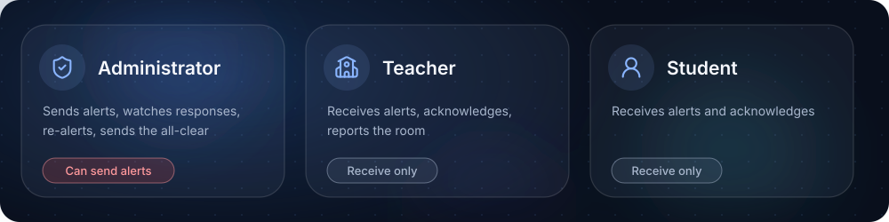
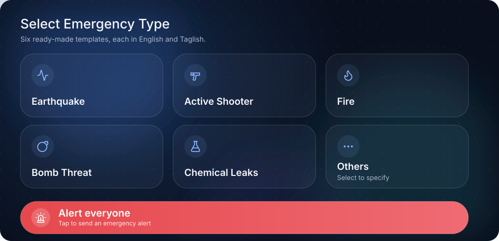
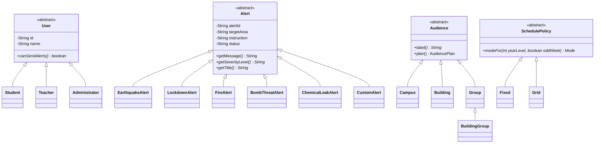

 

**Batangas State University – The National Engineering University, Alangilan Campus (CICS)**
Instructor: Sir Glenn M. Guinoban

<b>📑 Table of Contents</b>

1. [Project Title](#title)
2. [Project Description](#description)
3. [Problem Addressed](#problem)
4. [Objectives](#objectives)
5. [Target Users](#users)
6. [Main Features](#features)
7. [Technologies Used](#tech)
8. [Team Members and Roles](#team)
9. [OOP Concepts Demonstrated](#oop)
10. [Instructions for Running the Program](#run)
11. [Sample Screenshots](#screenshots)
12. [Known Limitations](#limitations)
13. [Future Improvements](#future)
14. [Project Contributors](#contributors)
15. [Important Links](#links)
16. [Acknowledgements](#thanks)

---

## 🏷️ 1. Project Title

**Ligtas** (Tagalog for "safe") — an Android app that sends emergency alerts to people on campus and shows the admins who has answered.

## 📖 2. Project Description

Ligtas is a phone app for BatStateU Alangilan. A verified **administrator** picks an emergency type (earthquake, fire, and so on) and sends a ready-made alert in **English or Taglish**. Everyone in the chosen group gets a push notification that **vibrates**. They tap **one button** to say "I got it." The admin can see, live, who has answered and who hasn't, and can re-alert the people who haven't. **Teachers** can also report if everyone in their room is accounted for.

### How an alert travels

## 🚨 3. Problem Addressed

During an emergency on campus, announcements by text, group chats, or word of mouth are slow, easy to miss, and nobody knows who actually saw the message. Ligtas fixes this by:

- 🔐 sending alerts only from **verified admins**, so fake alerts are not possible,
- 👀 letting the admin **see who has not answered** and alert them again,
- 🏫 letting teachers **confirm their room is safe**.
  
## 🎯 4. Objectives

1. Let verified admins send emergency alerts quickly using ready-made bilingual templates.
2. Make sure the alert is noticed (vibrating push notification) and can be answered in one tap.
3. Re-notify people who did not answer.
4. Let teachers report whether their room is accounted for.
5. Show admins a live view of who has and has not responded.
6. Keep students **receive-only**.
7. Show the four OOP concepts (abstraction, encapsulation, inheritance, polymorphism) in real working code.
   
## 👥 5. Target Users

| | User | What they do in Ligtas |
|:-:|---|---|
| 🧑‍💼 | **Administrator** | Sends alerts, watches responses, re-alerts, sends all-clear or false-alarm |
| 🧑‍🏫 | **Teacher** | Receives alerts, acknowledges, reports "room accounted for" |
| 🧑‍🎓 | **Student** | Receives alerts and acknowledges (cannot send anything) |

The role comes from the school roster. Nobody picks their own role.

## ✨ 6. Main Features

| | Feature | What it does |
|:-:|---|---|
| 🔑 | **School sign-in** | Sign in with the school Google account; the role (Student, Teacher, Admin) comes from a roster. |
| 📋 | **Pre-approved templates** | Earthquake, Fire, Active Shooter/Lockdown, Bomb Threat, Chemical Leak, and Others. |
| 🌐 | **English and Taglish** | Every alert goes out in both languages. |
| 📳 | **Vibrating push** | Shows on the lock screen and vibrates. |
| ☝️ | **One-tap acknowledgment** | One button to say "I got it." |
| 🔁 | **Re-alert** | Automatic re-alert of people who have not answered (timer set by the admin), plus a manual "Re-alert now" button. |
| 🏠 | **Teacher room report** | "All students accounted for", "Some students missing", or "Needs help". |
| 📊 | **Live status** | Delivered %, acknowledged %, and the names still waiting. |
| ✅ | **All-clear / False alarm** | Closes an alert with an update message. |
| 🔋 | **Alert Readiness** | Checks the phone's settings (notifications, vibration, lock screen, Do Not Disturb, battery) so alerts really reach the user. |
| 🎯 | **Audience choice** | Send to the whole campus, one building, or a college / program / year level, and skip groups that are online that week (schedule rules for odd/even weeks, on-site, online, no classes). |
| 🔏 | **Privacy consent** | A privacy notice the first time a user signs in. |
| 🛡️ | **Server checks** | The sender must be an admin, and an admin can alert only their own campus. |
| 💾 | **Saved records** | Alerts, acknowledgments and room reports are saved in the database (Firestore). |
| 🖥️ | **Admin web console** | A web console (Firebase Hosting) for managing the roster. |

## 🧰 7. Technologies Used

| Part | Technology |
|---|---|
| App logic (classes, alerts, users) |  |
| Screens (GUI) |   *(our instructor allowed another language for the GUI)* |
| Sign-in, database, push notifications |  Authentication, Firestore, Cloud Messaging |
| Small server that sends the pushes |   see the [`sender/`](sender) folder |
| Admin web console |   on Firebase Hosting, see the [`console/`](console) folder |
| Libraries | Google Credential Manager (sign-in), OkHttp (calls the sender server) |
| Tools |    |

> **Why a small server?** The Firebase free plan does not run server code, and the secret key that sends pushes must never be inside the app. So the app asks the Vercel server, the server checks the person is an admin, and only then sends the push.

## 🧑‍🤝‍🧑 8. Team Members and Roles

| Name | Student No. | Role |
|---|---|---|
| Nicole Atienza | 25-05756 | Project Leader |
| John Edward Bathan | 25-00966 | System/Design Lead |
| Aeron Guerra | 25-05697 | Documentation |
| Levi Hinggan | 25-06830 | Lead Programmer |

## 🧬 9. OOP Concepts Demonstrated

The class diagram image is in `docs/UML-Diagram.png`. A quick version is below.

| Concept | Plain meaning | Where it is in Ligtas |
|---|---|---|
| **Abstraction** | Show only what matters; leave the details to subclasses | `User` and `Alert` are **abstract** classes. They say *what* every user/alert must do (`canSendAlerts()`, `getSeverityLevel()`, `getTitle()`) but not *how*. `Audience` and `SchedulePolicy` are abstract too. |
| **Encapsulation** | Keep data private and give controlled access | Fields such as an alert's id, instruction and status are `private`. Other classes use getters like `getMessage()` and a setter like `setStatus()`. `RoomReport` is `final` with `final` fields and cleans its input in the constructor. `Mode` is an `enum`, so only valid values exist. |
| **Inheritance** | A child class reuses its parent | `Student`, `Teacher`, `Administrator` extend `User`. `FireAlert`, `EarthquakeAlert`, `LockdownAlert`, `BombThreatAlert`, `ChemicalLeakAlert`, `CustomAlert` extend `Alert`. `Campus`, `Building` and `Group` extend `Audience` (and `BuildingGroup` extends `Group`). `Fixed` and `Grid` extend `SchedulePolicy`. |
| **Polymorphism** | Same method call, different behavior | `canSendAlerts()` returns `false` for Student and Teacher but `true` for Administrator. `AlertService.sendAlert()` just calls it and does not care which kind of user it is. Each alert type also answers `getTitle()` its own way, and `AlertTemplate.createAlert()` hands back the right `Alert` subclass. |

Other Java topics used: **arrays** (alert instructions, odd/even week modes), **enum** (`Mode`: ONSITE, ONLINE, VACANT), **exception handling** (try/catch when opening phone settings), **interfaces/abstract methods** (`AlertDispatcher.Host`, `AlertTracker.Callback<T>`), and **collections** (lists and sets of people to alert).

## 🚀 10. Instructions for Running the Program

**What you need**

- 💻 A computer with **Android Studio** (we use *Rabbit 1 | 2026.2.1*)
- 📱 An **Android phone** (Android 7.0 or newer) with a USB cable, or an emulator
- 🌐 Internet connection on the phone
- ☁️ The alert sender runs online at `https://ligtas-sender.vercel.app`; you do not need to run it yourself
  **Steps**

1. Download or clone this repository.
2. Open the project folder in Android Studio and wait for Gradle to finish syncing.
3. `google-services.json` is already inside the `app/` folder (our Firebase project is `ligtas-eb260`), so no extra setup is needed for it.
4. On the phone: **Settings → About phone → tap Build number 7 times**, then turn on **USB debugging** in Developer options.
5. Plug in the phone, choose it at the top of Android Studio, and press **Run ▶**.
6. Tap **Sign in with school account**.
7. Open **Alert Readiness** and turn everything on so alerts can reach the phone.
   **Signing in:** Only accounts in our roster can use the app.

**Trying it out**

1. Phone A signs in as **Student** or **Teacher**.
2. Phone B (or the emulator) signs in as **Admin**.
3. Admin selects an emergency type → **Alert everyone**.
4. Phone A receives the vibrating alert → tap **Acknowledge**.
5. The Admin's status screen updates live.
> There is no `main()` method: this is an Android project, so the app starts at `LoginActivity`, and the Java source is in `app/src/main/java/com/ligtas/app/`.

## 📸 11. Sample Screenshots

*Screenshots are being added soon.*

## ⚠️ 12. Known Limitations

- **After a phone restarts**, Android may hold the first alert until the phone is unlocked once, plus about 30 seconds. This is an Android rule, not something our app can change.
- **Some phone brands** (for example Xiaomi) have their own Autostart and battery settings that apps **cannot read**. The user may need to check them by hand.
- If the **whole phone** is set to hide lock screen notifications, the app cannot override that setting.
- The **Do Not Disturb** notice can be hidden even though the phone still vibrates.
- Alerts need an **internet connection** (no SMS or offline mode).
- Only **registered roster accounts** can sign in.
- Some admin and teacher screens are in **English only**.
- Built on Firebase and Vercel **free plans**, so there are usage limits.
- **Two-person approval** for critical alerts (bomb threat, lockdown) is only a label; the app does not require a second admin.
- For very large audiences (over 1,500 people on the roster), per-person delivery tracking is turned off.
- Firestore security rules and large-scale testing have not been completed.
- The Java side has no custom exception classes and only a few unit tests so far; the Node sender has its own tests in `sender/`.
- Tested on a small number of devices only.
  
## 🔮 13. Future Improvements

- 🌐 Translate every screen to Taglish.
- 📡 Add SMS or offline fallback when there is no internet.
- 🗺️ Add a map or building floor plan for room reports.
- 🍎 Add an iPhone version.
- ⏱️ Make sure automatic re-alerts always run on the server, even when no admin screen is open.
- 🔐 Enforce two-person approval for critical alerts.
- 🧱 Split the biggest classes (`MainActivity`, `AlertTracker`) and add more unit tests.
- 📄 Add a report/export of past alerts for the school.
  
## 🙋 14. Project Contributors

<table align="center">
  <tr>
    <td align="center" width="200">
       
      <b>Atienza, Nicole</b> 
      
    </td>
    <td align="center" width="200">
       
      <b>Bathan, John Edward</b> 
      
    </td>
    <td align="center" width="200">
       
      <b>Guerra, Aeron</b> 
      
    </td>
    <td align="center" width="200">
       
      <b>Hinggan, Levi</b> 
      
    </td>
  </tr>
</table>

## 🔗 15. Important Links

| 📄 Project Proposal | 🧩 UML Diagram | 🛡️ Sender Server | 🖥️ Admin Console |
|:-:|:-:|:-:|:-:|
| [`docs/Project-Proposal.pdf`](docs/Project-Proposal.pdf) | [`docs/UML-Diagram.png`](docs/UML-Diagram.png) | [`sender/`](sender) | [`console/`](console) |

## 🙏 16. Acknowledgements

We thank our instructor for the guidance and feedback throughout this project, and everyone who tested Ligtas on their phones and gave us feedback.

Ligtas is built with the help of Firebase, Vercel, Google sign-in, Android Studio and the open-source libraries listed above.

**Ligtas** · made by Group 7 · BSIT-2114 · OOP 101

 