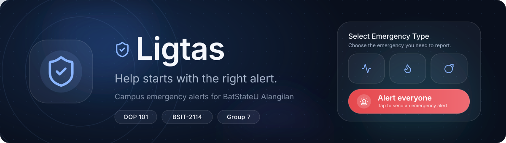
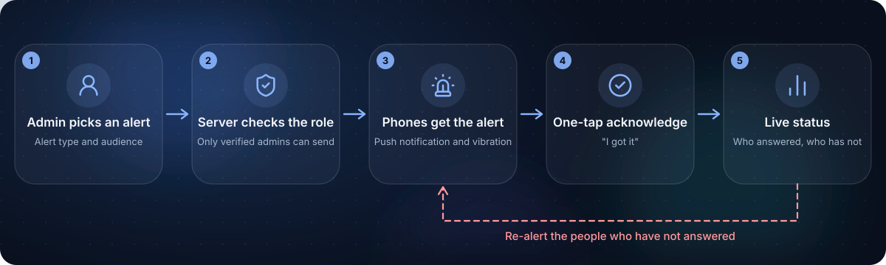

  

**Ligtas** is an Android app that sends emergency alerts to people on campus and shows the admins who has answered.
 
Batangas State University - The National Engineering University, Alangilan Campus (CICS)
OOP 101, BSIT-2114, Group 7
Instructor: Sir Glenn M. Guinoban
 
## Table of Contents
 
1. [Project Title](#1-project-title)
2. [Project Description](#2-project-description)
3. [Problem Addressed](#3-problem-addressed)
4. [Objectives](#4-objectives)
5. [Target Users](#5-target-users)
6. [Main Features](#6-main-features)
7. [Technologies Used](#7-technologies-used)
8. [Team Members and Roles](#8-team-members-and-roles)
9. [OOP Concepts Demonstrated](#9-oop-concepts-demonstrated)
10. [Instructions for Running the Program](#10-instructions-for-running-the-program)
11. [Sample Screenshots](#11-sample-screenshots)
12. [Known Limitations](#12-known-limitations)
13. [Future Improvements](#13-future-improvements)
14. [Project Contributors](#14-project-contributors)
## 1. Project Title
 
**Ligtas** (Tagalog for "safe"), a campus emergency alert app for Android.
 
## 2. Project Description
 
Ligtas is a phone app for BatStateU Alangilan. A verified administrator picks an emergency type, like earthquake or fire, and sends a ready-made alert in English or Taglish. Everyone in the chosen group gets a push notification that vibrates, and taps one button to say "I got it."
 
The admin can see who has answered and who hasn't, and can alert the people who haven't again. Teachers can also report whether everyone in their room is accounted for.
 
How an alert travels:
 

## 3. Problem Addressed
 
During an emergency on campus, announcements by text, group chats or word of mouth are slow and easy to miss, and nobody knows who actually saw the message. Ligtas deals with this by:
 
- sending alerts only from verified admins, so fake alerts are not possible,
- letting the admin see who has not answered and alert them again,
- letting teachers confirm that their room is safe.
## 4. Objectives
 
1. Let verified admins send emergency alerts quickly using ready-made bilingual templates.
2. Make sure the alert is noticed (vibrating push notification) and can be answered in one tap.
3. Re-notify people who did not answer.
4. Let teachers report whether their room is accounted for.
5. Show admins a live view of who has and has not responded.
6. Keep students receive-only.
7. Show the four OOP concepts (abstraction, encapsulation, inheritance, polymorphism) in real working code.
## 5. Target Users
 

| User | What they do in Ligtas |
|---|---|
| Administrator | Sends alerts, watches responses, re-alerts, sends all-clear or false alarm |
| Teacher | Receives alerts, acknowledges, reports "room accounted for" |
| Student | Receives alerts and acknowledges (cannot send anything) |
 
The role comes from the school roster. Nobody picks their own role.
 
## 6. Main Features
 

- Sign in with the school Google account. The role (Student, Teacher, Admin) comes from a roster.
- Ready-made templates: Earthquake, Fire, Active Shooter/Lockdown, Bomb Threat, Chemical Leak and Others.
- Every alert goes out in English and Taglish.
- The push notification shows on the lock screen and vibrates.
- One-tap acknowledgment.
- Automatic re-alert of people who have not answered (the admin sets the timer), plus a manual "Re-alert now" button.
- Teacher room report: "All students accounted for", "Some students missing" or "Needs help".
- Live status for admins: delivered %, acknowledged %, and the names still waiting.
- All-clear and False alarm messages.
- Alert Readiness screen that checks the phone's settings (notifications, vibration, lock screen, Do Not Disturb, battery) so alerts really reach the user.
- Audience choice: the whole campus, one building, or a college, program or year level. Groups that are online that week can be skipped (odd/even weeks, on-site, online, no classes).
- Privacy notice the first time a user signs in.
- The sender server checks that the sender is an admin, and an admin can only alert their own campus.
- Alerts, acknowledgments and room reports are saved in Firestore.
- Admin web console for managing the roster.
## 7. Technologies Used
 
| Part | Technology |
|---|---|
| App logic (classes, alerts, users) | Java |
| Screens (GUI) | Kotlin with Jetpack Compose (our instructor allowed another language for the GUI) |
| Sign-in, database, push notifications | Firebase: Authentication, Firestore, Cloud Messaging |
| Small server that sends the pushes | Node.js on Vercel, see the [`sender/`](sender) folder |
| Admin web console | HTML and JavaScript on Firebase Hosting, see the [`console/`](console) folder |
| Libraries | Google Credential Manager (sign-in), OkHttp (calls the sender server) |
| Tools | Android Studio, Git, GitHub |
 
**Why a small server?** The Firebase free plan does not run server code, and the secret key that sends pushes must never be inside the app. So the app asks the Vercel server, the server checks that the person is an admin, and only then sends the push.
 
## 8. Team Members and Roles
 
| Name | Student No. | Role |
|---|---|---|
| Nicole Atienza | 25-05756 | Project Leader |
| John Edward Bathan | 25-00966 | System/Design Lead |
| Aeron Guerra | 25-05697 | Documentation |
| Levi Hinggan | 25-06830 | Lead Programmer |
 
## 9. OOP Concepts Demonstrated
 
The class diagram image is in `docs/UML-Diagram.png`. A short version is below.
 

 
| Concept | Plain meaning | Where it is in Ligtas |
|---|---|---|
| Abstraction | Show only what matters, leave the details to subclasses | `User` and `Alert` are abstract classes. They say what every user or alert must do (`canSendAlerts()`, `getSeverityLevel()`, `getTitle()`) but not how. `Audience` and `SchedulePolicy` are abstract too. |
| Encapsulation | Keep data private and give controlled access | Fields such as an alert's id, instruction and status are `private`. Other classes use getters like `getMessage()` and a setter like `setStatus()`. `RoomReport` is `final` and cleans its input in the constructor. `Mode` is an `enum`, so only valid values exist. |
| Inheritance | A child class reuses its parent | `Student`, `Teacher` and `Administrator` extend `User`. `FireAlert`, `EarthquakeAlert`, `LockdownAlert`, `BombThreatAlert`, `ChemicalLeakAlert` and `CustomAlert` extend `Alert`. `Campus`, `Building` and `Group` extend `Audience`, and `BuildingGroup` extends `Group`. `Fixed` and `Grid` extend `SchedulePolicy`. |
| Polymorphism | Same method call, different behavior | `canSendAlerts()` returns `false` for Student and Teacher but `true` for Administrator. `AlertService.sendAlert()` just calls it and does not care which kind of user it is. Each alert type also answers `getTitle()` its own way, and `AlertTemplate.createAlert()` returns the right `Alert` subclass. |
 
Other Java topics used: arrays (alert instructions, odd/even week modes), enum (`Mode`: ONSITE, ONLINE, VACANT), exception handling (try/catch when opening phone settings), interfaces and abstract methods (`AlertDispatcher.Host`, `AlertTracker.Callback<T>`), and collections (lists and sets of people to alert).
 
## 10. Instructions for Running the Program
 
What you need:
 
- A computer with Android Studio (we use Rabbit 1 | 2026.2.1)
- An Android phone (Android 7.0 or newer) with a USB cable, or an emulator
- Internet connection on the phone
- The alert sender already runs online at `https://ligtas-sender.vercel.app`, so you do not need to run it yourself
Steps:
 
1. Download or clone this repository.
2. Open the project folder in Android Studio and wait for Gradle to finish syncing.
3. `google-services.json` is already inside the `app/` folder (our Firebase project is `ligtas-eb260`), so no extra setup is needed.
4. On the phone, go to Settings > About phone, tap Build number 7 times, then turn on USB debugging in Developer options.
5. Plug in the phone, choose it at the top of Android Studio, and press Run.
6. Tap "Sign in with school account".
7. Open Alert Readiness and turn everything on so alerts can reach the phone.
Only accounts in our roster can sign in.
 
Trying it out:
 
1. Phone A signs in as Student or Teacher.
2. Phone B (or the emulator) signs in as Admin.
3. The admin selects an emergency type and taps "Alert everyone".
4. Phone A receives the vibrating alert and taps Acknowledge.
5. The admin's status screen updates live.
There is no `main()` method. This is an Android project, so the app starts at `LoginActivity`, and the Java source is in `app/src/main/java/com/ligtas/app/`.
 
## 11. Sample Screenshots
 
Screenshots will be added here.
 
## 12. Known Limitations
 
- After a phone restarts, Android may hold the first alert until the phone is unlocked once, plus about 30 seconds. This is an Android rule, not something our app can change.
- Some phone brands (for example Xiaomi) have their own Autostart and battery settings that apps cannot read. The user may need to check them by hand.
- If the whole phone is set to hide lock screen notifications, the app cannot override that.
- The Do Not Disturb notice can be hidden even though the phone still vibrates.
- Alerts need an internet connection (no SMS or offline mode).
- Only registered roster accounts can sign in.
- Some admin and teacher screens are in English only.
- Built on Firebase and Vercel free plans, so there are usage limits.
- Two-person approval for critical alerts (bomb threat, lockdown) is only a label. The app does not require a second admin.
- For very large audiences (over 1,500 people on the roster), per-person delivery tracking is turned off.
- Firestore security rules and large-scale testing are not finished.
- The Java side has no custom exception classes and only a few unit tests so far. The Node sender has its own tests in `sender/`.
- Tested on a small number of devices only.
## 13. Future Improvements
 
- Translate every screen to Taglish.
- Add SMS or an offline fallback for when there is no internet.
- Add a map or building floor plan for room reports.
- Add an iPhone version.
- Make automatic re-alerts always run on the server, even when no admin screen is open.
- Enforce two-person approval for critical alerts.
- Split the biggest classes (`MainActivity`, `AlertTracker`) and add more unit tests.
- Add a report or export of past alerts for the school.
## 14. Project Contributors
 
<table align="center">
  <tr>
    <td align="center" width="200">
       
      <b>Atienza, Nicole</b> 
      
    </td>
    <td align="center" width="200">
       
      <b>Bathan, John Edward</b> 
      
    </td>
    <td align="center" width="200">
       
      <b>Guerra, Aeron</b> 
      
    </td>
    <td align="center" width="200">
       
      <b>Hinggan, Levi</b> 
      
    </td>
  </tr>
</table>
 
